# D&D5e Spell Advancement

<p align="center">
  
</p>

**Versión actual — Foundry v14**


[](https://github.com/foundryvtt-sinregistrar/dnd5e-spell-advancement/releases/latest)
[](https://github.com/foundryvtt-sinregistrar/dnd5e-spell-advancement/releases/latest)

[](https://github.com/foundryvtt-sinregistrar/dnd5e-spell-advancement/releases)

Requiere Foundry VTT 14.367 o posterior y D&D5e 6.0.5. Instálalo desde la
URL de manifiesto publicada en la release y actívalo en el mundo.

Módulo local para añadir avances `ItemChoice` nativos de D&D5e a clases que
necesitan abrir el Compendium Browser al obtener conjuros. No modifica ningún
compendio oficial.

Para detalles de implementación, compatibilidad y API, consulta la
[documentación técnica](docs/DOCUMENTACION-TECNICA.md).

---

## ✨ Mejoras en la creación y subida de nivel de personajes mágicos

**D&D5e Spell Advancement** amplía el sistema de progresión de personajes de Dungeons & Dragons 5e en Foundry VTT, incorporando la **selección de trucos y conjuros directamente al proceso de creación del personaje y subida de nivel**.

En lugar de obligar al jugador a buscar manualmente los nuevos conjuros, importarlos a su ficha y comprobar cuáles puede elegir, el módulo integra estas elecciones en el sistema nativo de avances (*Advancement*) de D&D5e.

### 🎯 ¿Qué cambia para el jugador?

Al crear un personaje de una clase compatible o subir de nivel, el módulo incorpora los avances de selección de conjuros que correspondan a su progresión.

El proceso permite:

- **Seleccionar nuevos conjuros durante la subida de nivel**, utilizando el mismo gestor que Foundry emplea para los demás avances del personaje.
- **Abrir automáticamente el Navegador de Compendios de D&D5e** cuando corresponde realizar una nueva elección.
- **Mostrar únicamente conjuros de las listas permitidas** para la clase o subclase.
- **Respetar los niveles de conjuro disponibles**, impidiendo seleccionar conjuros superiores a los que permite la progresión del personaje.
- **Elegir trucos y conjuros por separado**, respetando las cantidades establecidas para cada nivel.
- **Evitar elecciones duplicadas**, detectando conjuros que ya posee el personaje, incluso cuando proceden de compendios diferentes.
- **Registrar las elecciones en el historial de avances**, manteniendo la integración con las futuras subidas de nivel.

Todo ello se realiza mediante los mecanismos nativos de Foundry VTT y D&D5e, sin sustituir el Navegador de Compendios ni modificar los compendios oficiales.

### 🧙 Ejemplo práctico: subir de nivel

Imagina que un Clérigo alcanza el nivel 2.

**Sin los avances proporcionados por el módulo:**

El jugador puede tener que consultar su progresión, localizar los nuevos conjuros permitidos, buscarlos en los compendios y añadirlos manualmente a su ficha.

**Con D&D5e Spell Advancement:**

1. El jugador inicia la subida de nivel del personaje.
2. Foundry muestra los avances correspondientes, incluyendo la nueva selección de conjuros.
3. El Navegador de Compendios presenta los conjuros de la lista de Clérigo que cumplen las restricciones de la elección.
4. El jugador selecciona el nuevo conjuro.
5. D&D5e incorpora el conjuro a su personaje y registra la elección en el avance de clase.

El resultado es una progresión más integrada, organizada y sencilla para jugadores y directores de juego.

### 📚 Adaptado a las distintas clases mágicas

El módulo tiene en cuenta las diferencias de progresión entre las clases compatibles:

| Clase | Mejora incorporada |
|---|---|
| **Clérigo** | Selección de trucos y conjuros preparados según su progresión. |
| **Bardo** | Elección de conjuros y compatibilidad con Secretos mágicos desde nivel 10. |
| **Druida** | Incorporación progresiva de trucos y conjuros preparados. |
| **Hechicero** | Selección de conjuros conforme a la progresión de su clase. |
| **Brujo** | Selección de trucos y conjuros de Magia del pacto. |
| **Explorador** | Selección de conjuros según su progresión de semilanzador. |
| **Paladín** | Incorporación de conjuros preparados al avanzar de nivel. |
| **Mago** | Selección de conjuros para el libro de conjuros, manteniendo separada su preparación. |
| **Caballero arcano** | Selección de trucos y conjuros de Mago según su progresión de subclase. |
| **Tramposo arcano** | Selección de conjuros y concesión de Mano de mago mediante un avance nativo. |

### 🔄 Compatible con personajes existentes

El módulo también permite incorporar estos avances a personajes creados o importados anteriormente.

Desde **Ajustes de partida → Procesar Actores existentes**, el director de juego puede analizar los personajes compatibles y gestionar sus elecciones pendientes.

El proceso:

- Reconoce los conjuros existentes con procedencia identificable.
- Registra como históricas las elecciones que ya están cubiertas.
- Evita volver a ofrecer conjuros equivalentes.
- Solicita únicamente las elecciones que siguen pendientes.
- Permite pausar y reanudar el procesamiento de personajes.

**Los conjuros existentes se conservan**: la reconciliación de avances no los elimina ni los sustituye automáticamente.

### ⚙️ Integración nativa y limitaciones

D&D5e Spell Advancement utiliza `ItemChoice` y `AdvancementManager`, por lo que las elecciones forman parte del propio sistema de progresión de D&D5e.

El módulo no implementa un sistema de lanzamiento de conjuros alternativo, no modifica los compendios oficiales y no automatiza los reemplazos diarios de conjuros ni la modificación de elecciones ya confirmadas.

Su objetivo es **hacer que aprender y seleccionar conjuros forme parte natural de la creación del personaje y de cada subida de nivel**.

---

## Demostración visual: selección de conjuros al subir de nivel
Estas capturas proceden de una partida real de Foundry VTT. Muestran la subida de nivel de un **Clérigo 1 → 2**, de un **Mago 5 → 6** y el procesamiento de un actor importado.

El módulo añade avances de elección de conjuros al flujo nativo de D&D5e: el jugador selecciona desde el Navegador de Compendios, los conjuros elegidos se registran en el avance y los personajes importados pueden reconciliar sus elecciones históricas.

> **Nota:** las capturas también muestran la interfaz del sistema D&D5e y otros paquetes instalados. No todas las ventanas o funcionalidades visibles pertenecen a este módulo.

### Clérigo: nivel 1 → 2
El personaje obtiene una nueva elección de conjuro preparado dentro del propio proceso de subida de nivel.

<p align="center">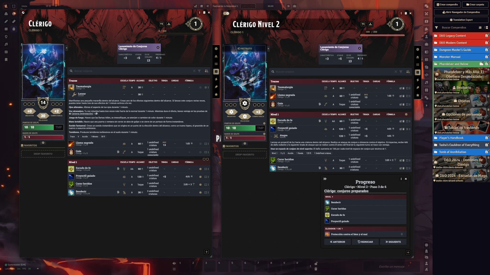</p>

<details>
<summary><strong>Ver las 9 capturas del proceso del Clérigo</strong></summary>

**01. Ficha inicial de Clérigo de nivel 1**

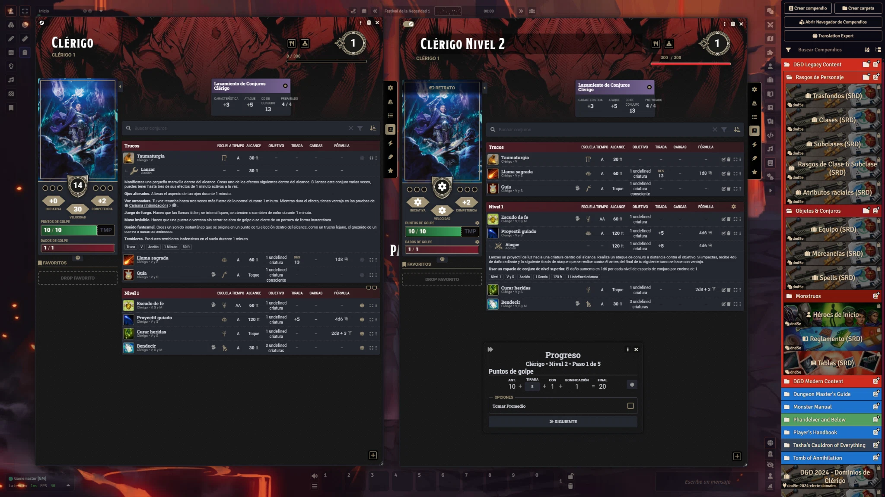

**02. Paso 1: puntos de golpe**

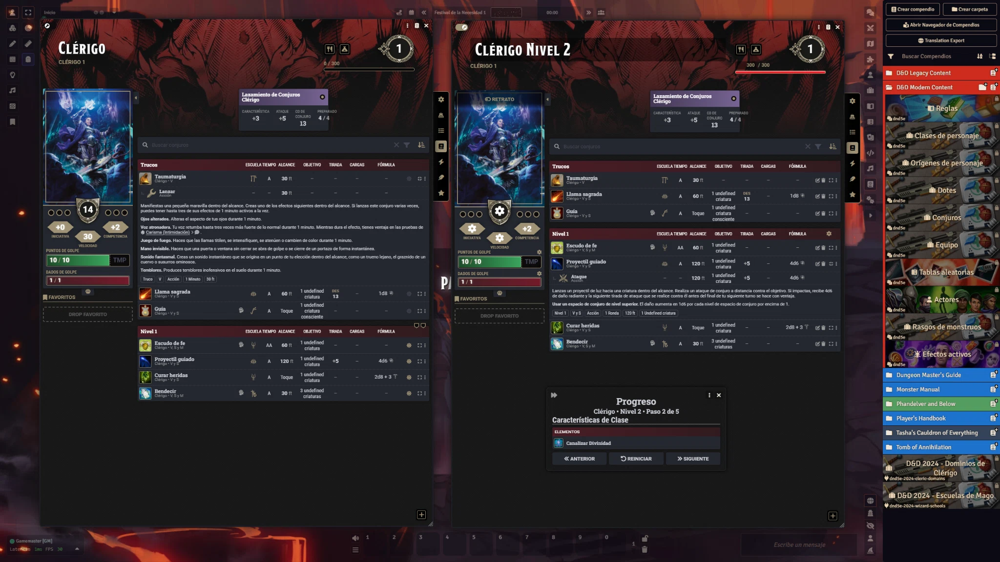

**03. Paso 2: características de clase**

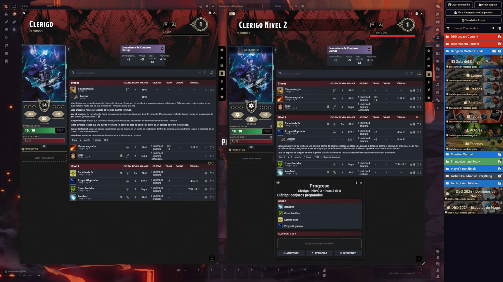

**04. Paso 3: elegir nuevo conjuro preparado**

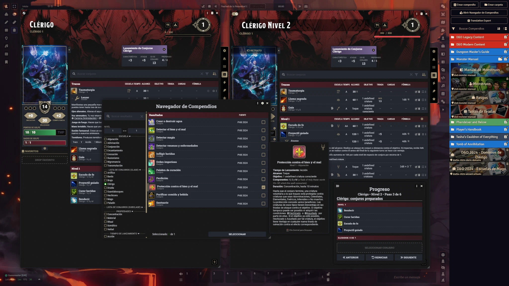

**05. Navegador de Compendios con lista de Clérigo y filtros**


**06. Conjuro incorporado a la elección del avance**

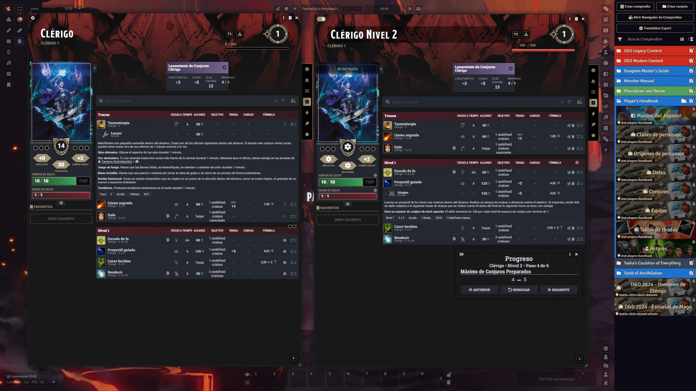

**07. Avance: límite de conjuros preparados**

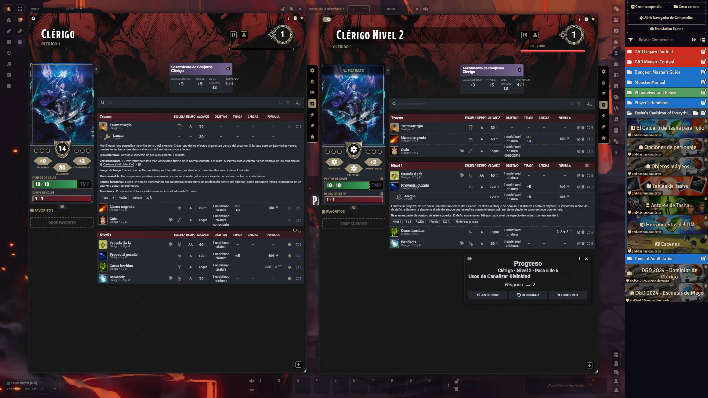

**08. Avances adicionales de la clase**

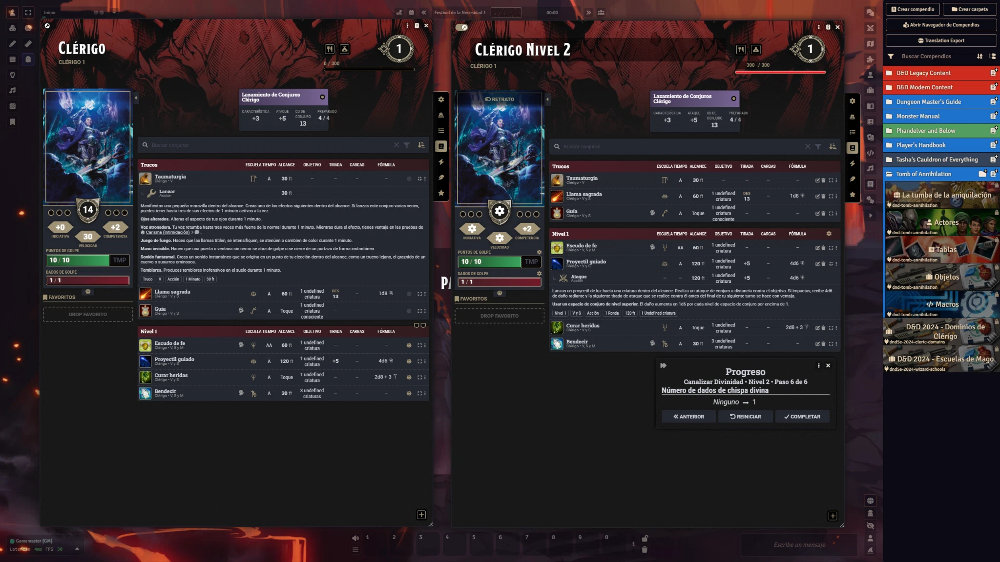

**09. Resultado final: Clérigo de nivel 2**

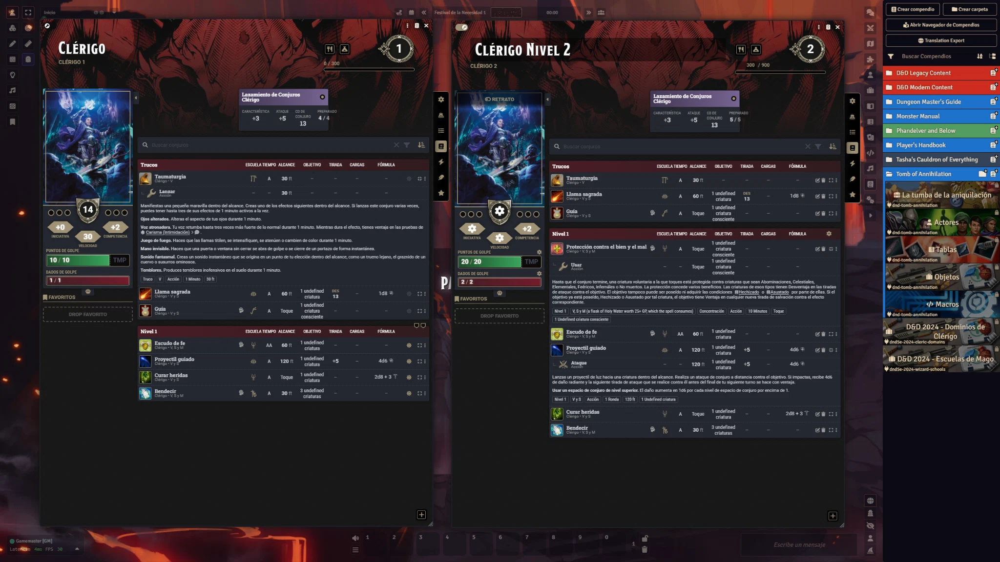

</details>

### Mago: nivel 5 → 6
El avance del Mago muestra la selección de dos conjuros para el libro, el filtrado del navegador y el registro de elecciones. También se incluye el procesamiento de un personaje importado.

<p align="center">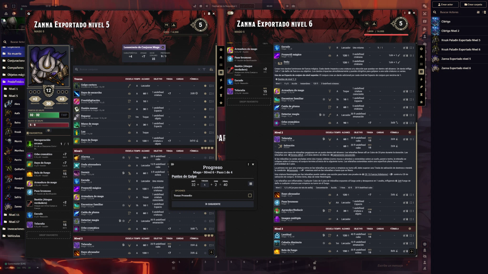</p>

<details>
<summary><strong>Ver las 10 capturas del Mago y los actores importados</strong></summary>

**01. Mago de nivel 5 antes del avance**


**02. Elección de conjuros para el libro de conjuros**

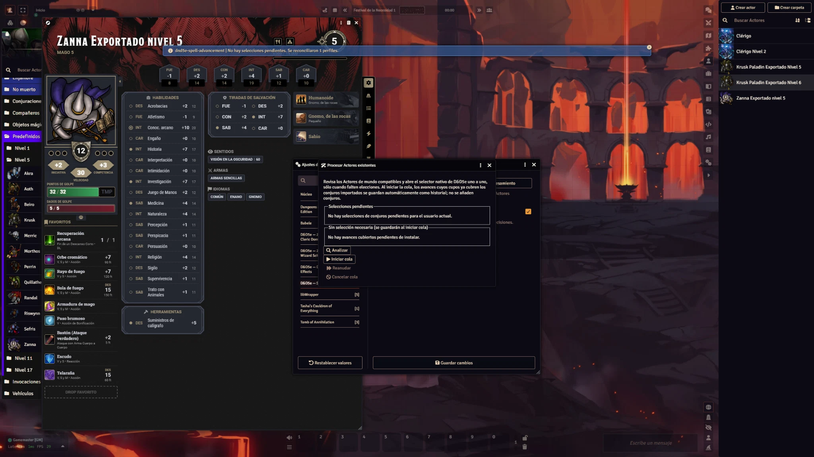

**03. Navegador de Compendios para el Mago**


**04. Navegador con filtro de nivel y conjuros disponibles**

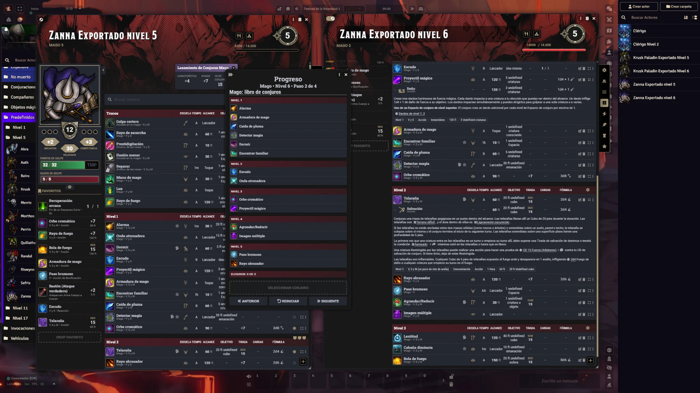

**05. Dos conjuros añadidos a la elección**

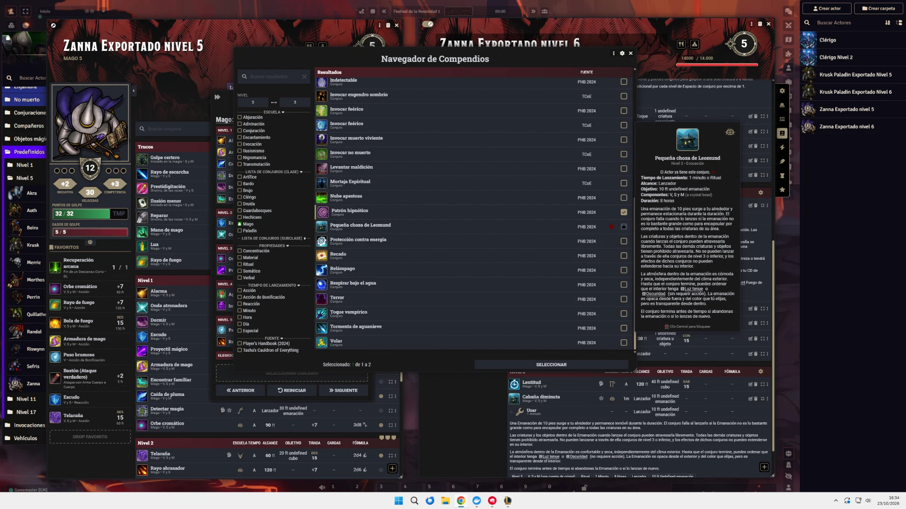

**06. Avance: límite de conjuros preparados**


**07. Paso de rasgos de subclase**

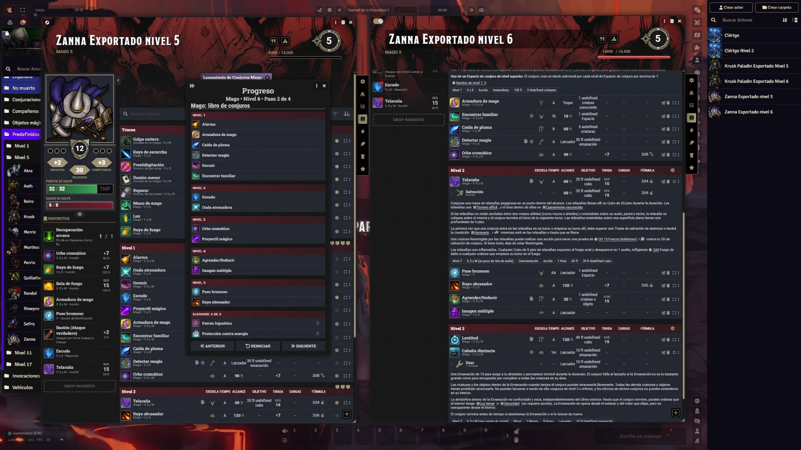

**08. Resultado final: Mago de nivel 6**

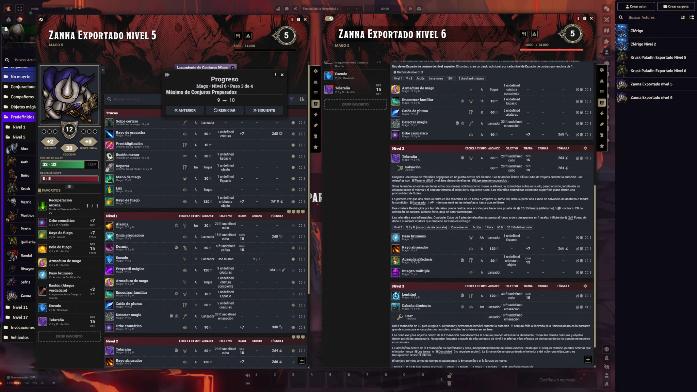

**09. Procesamiento de actores existentes: análisis**

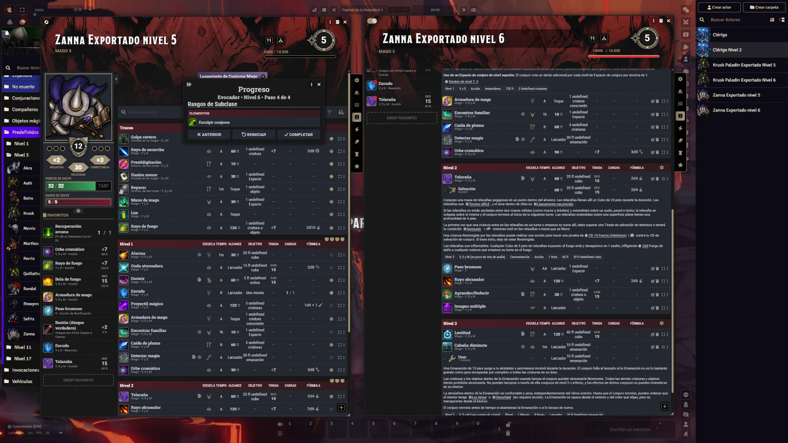

**10. Actores importados: historial reconciliado**

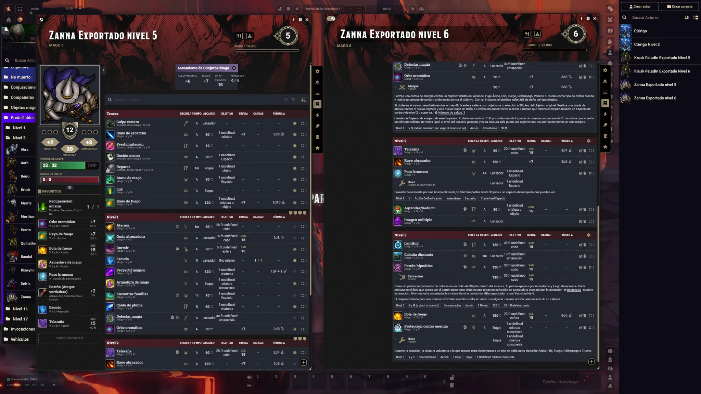

</details>

**Características visibles en las demostraciones:** integración con el gestor de avances de D&D5e, navegador de compendios con filtros, registro de las elecciones y reconciliación de conjuros importados.

## Alcance actual

Clérigo (PHB 2024):

- trucos de la lista de Clérigo: 3 a nivel 1, +1 a niveles 4 y 10;
- conjuros de la lista de Clérigo, excluyendo trucos: incrementos que llegan a
  22 conjuros preparados a nivel 20;
- el nivel máximo de conjuro se limita de forma nativa a los espacios de
  conjuro disponibles del actor;
- el Navegador de Compendios permite acotar el intervalo de nivel mostrado;
  por ejemplo, cuando estén disponibles los niveles 1 y 2, se puede mostrar
  1–2, sólo 1–1 o sólo 2–2, sin poder ampliar el intervalo permitido;
- los trucos se crean siempre preparados y los conjuros como preparados, con
  Sabiduría como característica de lanzamiento.

Al crear un Clérigo, el módulo inicia un segundo `AdvancementManager` nativo
para registrar las elecciones. En subidas posteriores, D&D5e incorpora esos
avances en el mismo flujo normal de subida de nivel.

Bardo (PHB 2024):

- trucos de la lista de Bardo: 2 a nivel 1, +1 a niveles 4 y 10;
- conjuros preparados de Bardo hasta nivel 9, restringidos al nivel de espacio
  disponible;
- desde nivel 10, `Secretos mágicos` permite cada nuevo conjuro preparado de
  las listas de Bardo, Clérigo, Druida y Mago, tal como indica el rasgo oficial;
- los conjuros usan Carisma y se crean preparados.

Otras clases base del PHB 2024:

| Clase | Lista | Aptitud | Selecciones implementadas |
| --- | --- | --- | --- |
| Druida | Druida | Sabiduría | Trucos y conjuros preparados |
| Hechicero | Hechicero | Carisma | Trucos y conjuros preparados |
| Brujo | Brujo | Carisma | Trucos y conjuros de Magia del pacto |
| Explorador | Explorador | Sabiduría | Conjuros preparados |
| Paladín | Paladín | Carisma | Conjuros preparados |
| Mago | Mago | Inteligencia | Trucos y conjuros del libro de conjuros |

El Mago selecciona seis conjuros de nivel 1 para el libro y dos por cada nivel
posterior. Estos se añaden sin preparar; el límite oficial de conjuros
preparados permanece en la clase y el jugador los prepara desde la ficha.

Subclases del PHB instaladas:

- **Caballero arcano**: dos trucos de Mago en nivel 3, otro en nivel 10 y los
  incrementos de conjuros preparados de la tabla de lanzador de un tercio.
- **Tramposo arcano**: la misma progresión, más `Mano de mago` concedida de
  forma fija en nivel 3; sus dos primeros trucos siguen siendo elecciones.

## Actores existentes

El módulo no modifica automáticamente actores ya existentes. Para iniciar la
configuración de un Clérigo existente, ejecuta como propietario del Actor:

```js
await game.modules.get("dnd5e-spell-advancement").api.configureActorCleric(actor);
```

Para un Bardo existente:

```js
await game.modules.get("dnd5e-spell-advancement").api.configureActorBard(actor);
```

Las demás clases base se configuran con su identificador de D&D5e:

```js
await game.modules.get("dnd5e-spell-advancement")
  .api.configureActorClass(actor, "druid");
```

Identificadores disponibles: `druid`, `sorcerer`, `warlock`, `ranger`,
`paladin` y `wizard`.

Las subclases se detectan por su UUID de origen oficial al añadirse al Actor.

## Actores importados

Al configurar un Actor importado, el módulo registra los conjuros de su clase
ya existentes como elecciones históricas. El Compendium Browser nativo excluye
los conjuros que el Actor ya posee, para que no puedan volver a elegirse al
resolver los avances pendientes.

Para procesar todos los Actores de mundo que poseas sin buscarlos uno a uno,
abre **Ajustes de partida → Procesar Actores existentes → Abrir
procesamiento** como GM. La ventana muestra los avances pendientes y permite
iniciar, reanudar o cancelar la cola. También puedes ejecutar esta macro como
GM o propietario de los Actores:

El ajuste de mundo **Mostrar registro detallado en consola** permite activar o
desactivar las trazas de diagnóstico del análisis y de la cola. Está activado
por defecto y sólo lo puede cambiar un GM.

```js
await game.modules.get("dnd5e-spell-advancement").api.configureExistingActors();
```

Al iniciar la cola, los avances cuyos cupos ya están cubiertos se guardan
automáticamente en el perfil de avance del Item de clase, usando como historial
los conjuros ya importados. No se añaden, eliminan ni modifican conjuros. Así,
una subida de nivel posterior no vuelve a pedir las elecciones históricas. La
macro abre un `AdvancementManager` nativo sólo para los déficits restantes.
Completa las elecciones de un Actor para pasar automáticamente al siguiente. Si
cierras un selector, la cola queda pausada y puedes reintentar esa misma entrada
con:

```js
await game.modules.get("dnd5e-spell-advancement").api.resumeExistingActorBatch();
```

Para abandonar la cola, sin deshacer los Actores ya completados:

```js
game.modules.get("dnd5e-spell-advancement").api.cancelExistingActorBatch();
```

`actor` debe ser el Actor seleccionado o una referencia al Actor en las macros
individuales anteriores.
